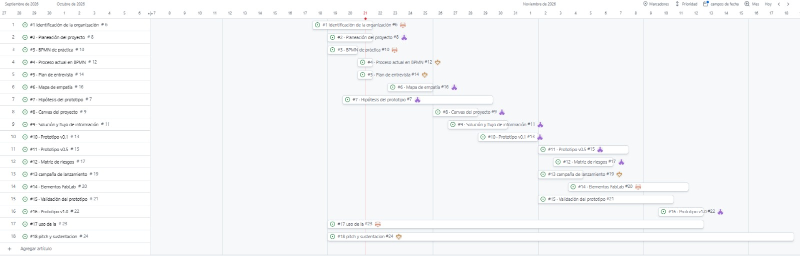

Planeación proyecto  
Roles  
LP – Lider proyecto: Santiago Niño  
AP – Analista de procesos: Samuel Pinzón  
UX – Usuario y campaña: Valentina Pineda  
PR – Prototipo:   
 
Issues a cargo  
ROL | Issues | Justificación |  
Líder | #1 Identificación de la organización, #3 BPMN de práctica, #14 Elementos FabLab, #17 Uso de IA | Entregables de coordinación y documentación general del proyecto |  
AP | #2 Planeación del proyecto, #6 Mapa de empatía, #7 Hipótesis del prototipo, #8 Canvas del proyecto, #9 Solución y flujo de información, #11 Prototipo v0.5, #12 Matriz de riesgos | Análisis y estructuración del proyecto, y flujo de información |  
UX | #4 Proceso actual en BPMN, #5 Plan de entrevista, #13 Campaña de lanzamiento, #18 Pitch y sustentación | Contacto con el usuario, comunicación y presentación final |  
PR | #10 Prototipo v0.1, #16 Prototipo v1.0, #15 Validación del prototipo | Construcción y validación de los prototipos |  
 
Hitos  
Semana # | Fecha limite | Resultado | 
Semana 1 | 21/10/2026 | Organización identificada y tablero con Gantt | 
Semana 2 | 25/10/2026 | BPMN del proceso actual, entrevista y mapa de empatía | 
Semana 3 | 01/11/2026 | Canvas, solución y prototipo v0.1 | 
Semana 4 | 08/11/2026 | Prototipo v0.5, riesgos y campaña | 
Semana 5 | 12/11/2026 | Validación, FabLab, prototipo v1.0 y pre-sustentación | 
Semana 6 | 13/11/2026 | Exposición ante jurados | 
 
Tablero y cronograma  
  
  
