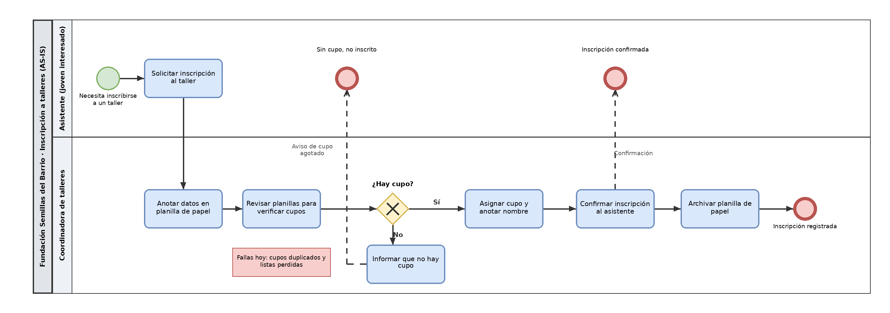
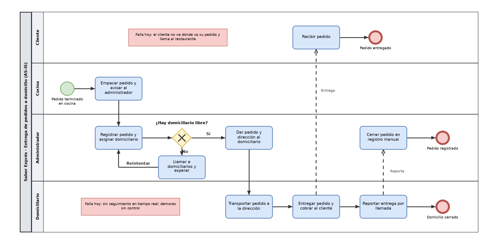

# Proceso actual

## 1. BPMN de práctica

**Declaración de IA:**
Claude (Sonnet 5.5) – 23/10/2026 – prompt registrado en docs/11-uso-ia.md

## 2. El proceso elegido
- **Nombre del proceso:** Entrega de pedidos a domicilio, desde que salen de la cocina hasta que llegan al cliente
- **Carriles (responsables):** Cliente, Cocina, Administrador, Domiciliario
- **Fuente (contacto, cargo y fecha):** [Nombre], administrador del restaurante Sabor Exprés – [dd/mm/aaaa] (contacto de Samuel)

## 3. Pasos del proceso

| # | Paso (verbo + objeto) | Responsable |
|---|---|---|
| 1 | Empacar el pedido y avisar al administrador | Cocina |
| 2 | Registrar el pedido y asignar domiciliario | Administrador |
| 3 | Dar el pedido y la dirección al domiciliario | Administrador |
| 4 | Transportar el pedido a la dirección | Domiciliario |
| 5 | Entregar el pedido y cobrar | Domiciliario |
| 6 | Recibir el pedido | Cliente |
| 7 | Reportar la entrega por llamada | Domiciliario |
| 8 | Cerrar el pedido en el registro manual | Administrador |

**Decisión:** ¿Hay domiciliario libre? Sí: Dar el pedido y la dirección al domiciliario (paso 3). No: Llamar a los domiciliarios y esperar, y volver al paso 2.

## 4. Diagrama BPMN

## 5. Puntos críticos

| PC | Qué pasa (se demora, se repite o se pierde) | Evidencia (dato o frase del contacto, con fecha) |
|---|---|---|
| PC1 | El cliente no puede ver dónde va su pedido y llama al restaurante para preguntar | [evidencia – dd/mm/aaaa] |
| PC2 | No hay seguimiento en tiempo real: las demoras en la entrega no se controlan | [evidencia – dd/mm/aaaa] |
| PC3 | La asignación del domiciliario se hace por llamada y puede demorar la salida del pedido | [evidencia – dd/mm/aaaa] |

## 6. Uso de IA

| Herramienta y versión | Fecha | Prompt |
|---|---|---|
| Claude Sonnet 5.5 | 23/10/2026 | Actúa como analista de procesos. A partir de esta descripción del proceso de Sabor Exprés, genera un diagrama BPMN 2.0 con carriles por responsable, eventos de inicio y fin, tareas y compuertas. Entrega el resultado en XML para abrirlo en draw.io y en PNG. |
