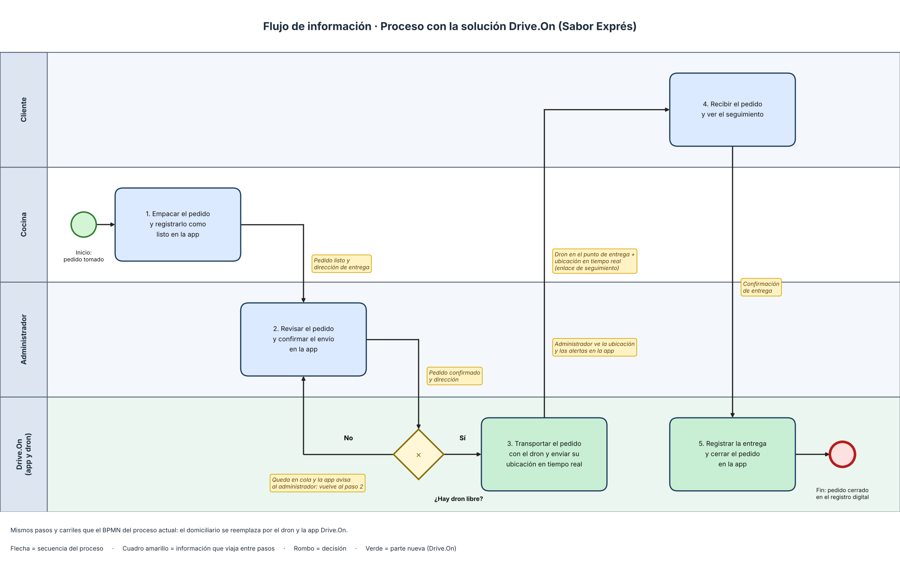

# 06 · Solución y flujo de información  
 

## Solución propuesta

**Qué cambia en el proceso con la solución (máximo 5 líneas):**

1. La cocina marca el pedido como listo en la app Drive.On y el administrador lo confirma desde un solo lugar, sin llamadas.
2. La app asigna un dron libre; si no hay ninguno, deja el pedido en cola y avisa al administrador.
3. El dron lleva el pedido a la dirección y envía su ubicación en tiempo real, así el cliente y el administrador ven dónde va.
4. El cliente recibe el pedido sin necesidad de llamar al restaurante a preguntar.
5. La app registra la entrega, cierra el pedido en un registro digital y alerta si hubo demora.

## Flujo de información

| Paso | Entrada (qué información llega) | Proceso (qué se hace) | Responsable (quién) | Salida (qué información sale) |
|---|---|---|---|---|
| 1 | Pedido del cliente preparado en cocina | Empacar el pedido y marcarlo como listo en la app | Cocina | Pedido listo con su dirección de entrega |
| 2 | Pedido listo con su dirección de entrega | Revisar el pedido y confirmar el envío; la app busca un dron libre (si no hay, el pedido queda en cola, la app avisa y se repite este paso) | Administrador | Pedido confirmado con dron asignado |
| 3 | Pedido confirmado, dron asignado y dirección | Transportar el pedido a la dirección con el dron | Dron / app Drive.On | Ubicación en tiempo real y pedido llegado al punto de entrega |
| 4 | Dron en el punto de entrega y enlace de seguimiento | Recibir el pedido y ver el estado de la entrega | Cliente | Confirmación de entrega |
| 5 | Confirmación de entrega | Registrar la entrega, cerrar el pedido y alertar si hubo demora | App Drive.On | Pedido cerrado en el registro digital y alerta de demora (si la hubo) |

## Antes y después

| Proceso actual | Proceso con la solución |
|---|---|
| La cocina empaca el pedido y avisa al administrador | La cocina empaca el pedido y lo marca como listo en la app |
| El administrador registra el pedido y llama a los domiciliarios para asignar uno; si no hay libre, espera | El administrador confirma el pedido en la app y esta asigna un dron libre; si no hay, el pedido queda en cola y la app avisa |
| El domiciliario recibe el pedido y la dirección y lo transporta, sin seguimiento | El dron transporta el pedido y envía su ubicación en tiempo real |
| El cliente no ve dónde va su pedido y llama al restaurante para preguntar | El cliente sigue su pedido con un enlace de seguimiento y no necesita llamar |
| El domiciliario entrega, cobra y reporta la entrega por llamada | El cliente recibe el pedido y la app registra la entrega automáticamente |
| El administrador cierra el pedido en el registro manual y las demoras no se controlan | La app cierra el pedido en un registro digital y alerta cuando hay demora |
