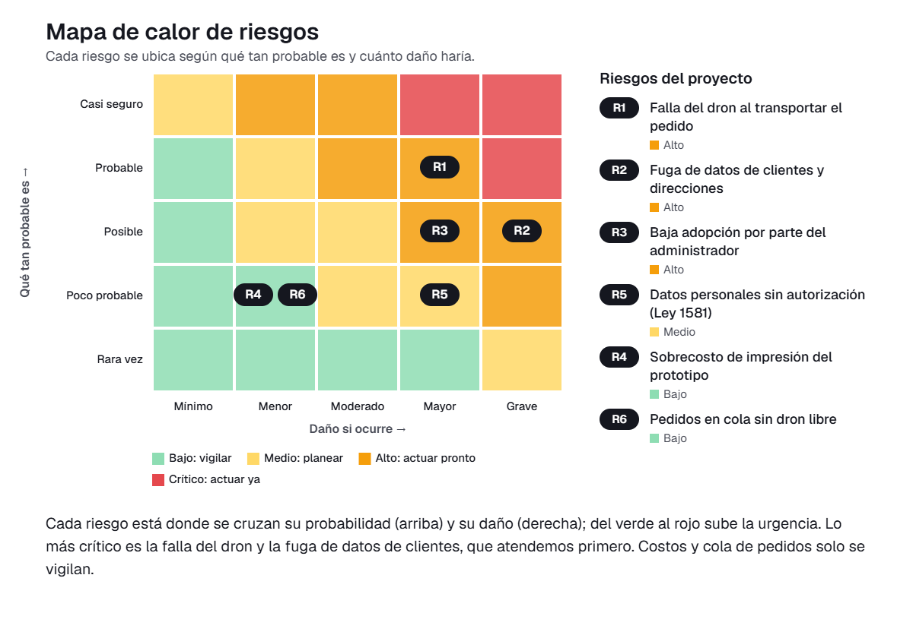

# 09 · Gestión de riesgos

En este documento presentamos la matriz de riesgos de implementar Drive.On en Sabor Exprés, el restaurante de comida rápida con domicilios del que parte el proyecto. Identificamos seis riesgos, uno por cada categoría, y los valoramos con probabilidad (1-5) × impacto (1-5). Los niveles son: bajo (1-4), medio (5-9), alto (10-16) y crítico (20-25).

## Matriz de riesgos

| ID | Riesgo | Categoría | P | I | Nivel | Tratamiento | Acción | Responsable | Fecha |
|---|---|---|---|---|---|---|---|---|---|
| R1 | Falla del dron al transportar el pedido | Tecnológico | 4 | 4 | 16 · Alto | Mitigar | Probar el dron impreso con una carga simulada en un recorrido corto y ajustar el compartimiento del pedido hasta que no se derrame | PR | 12 de noviembre |
| R2 | Fuga de datos de clientes y direcciones | Datos y ciberseguridad | 3 | 5 | 15 · Alto | Mitigar | Pedir usuario y contraseña para entrar a la app, guardar solo los datos necesarios (nombre, pedido y dirección) y usar datos ficticios en las pruebas | AP | 10 de noviembre |
| R3 | Baja adopción por parte del administrador | Personas y adopción | 3 | 4 | 12 · Alto | Mitigar | Hacer una sesión de prueba guiada con el administrador, recoger sus comentarios y entregarle una guía de uso de una página | UX | 13 de noviembre |
| R4 | Sobrecosto de impresión del prototipo | Financiero | 2 | 2 | 4 · Bajo | Mitigar | Cotizar la impresión antes de iniciarla, imprimir las piezas en una sola tanda y reservar un margen dentro de los 100.000 pesos disponibles | LP | 7 de noviembre |
| R5 | Datos personales sin autorización (Ley 1581) | Legal | 2 | 4 | 8 · Medio | Evitar | Incluir en la app un aviso de autorización para el tratamiento de datos personales conforme a la Ley 1581 de 2012 y no usar datos reales de clientes en el prototipo | LP | 11 de noviembre |
| R6 | Pedidos en cola sin dron libre | Operativo | 2 | 2 | 4 · Bajo | Aceptar | Mantener la cola de pedidos con aviso al administrador que ya prevé la app y verificar su funcionamiento en la prueba final | AP | 14 de noviembre |

## Riesgos altos y críticos: plan de respuesta

No identificamos riesgos críticos. Los tres riesgos altos son los que atendemos primero.

### R1 · Falla del dron al transportar el pedido (nivel 16)

La hipótesis del proyecto depende de que el dron lleve el pedido sin derramarlo y sin que se enfríe. Si falla, el administrador no tendría una alternativa real a los domiciliarios en moto. Probamos el prototipo con una carga simulada y un recorrido corto, corregimos el diseño del compartimiento y repetimos la prueba hasta que el pedido llegue completo. Responsable: PR. Fecha: 12 de noviembre.

### R2 · Fuga de datos de clientes y direcciones (nivel 15)

La solución maneja datos de los clientes de los domicilios, sus pedidos y sus direcciones de entrega. Una filtración dañaría la confianza en el restaurante. Restringimos el acceso a la app con usuario y contraseña, limitamos la información guardada a lo necesario y usamos datos ficticios mientras el prototipo se prueba. Responsable: AP. Fecha: 10 de noviembre.

### R3 · Baja adopción por parte del administrador (nivel 12)

El administrador maneja hoy los domicilios por llamada y con registro manual. Si la app le resulta confusa o poco confiable, volverá a su forma de trabajo actual. Hacemos una sesión de prueba guiada con él, ajustamos las pantallas según lo que nos diga y le dejamos una guía corta de uso. Responsable: UX. Fecha: 13 de noviembre.

### Cómo leer el mapa de calor

Cada riesgo aparece en la casilla donde se cruzan qué tan probable es (de abajo hacia arriba) y cuánto daño haría si ocurre (de izquierda a derecha). El color va del verde, que significa tranquilidad, al rojo, que significa urgencia. En nuestro proyecto, los que quedaron más arriba y a la derecha son «Falla del dron al transportar el pedido» y «Fuga de datos de clientes y direcciones». Preocupan porque el restaurante necesita que el pedido llegue completo y porque sus clientes nos confían su dirección. Por eso lo primero que haremos es probar el dron con carga simulada y proteger el acceso a la app. Muy cerca está «Baja adopción por parte del administrador», que atendemos con una sesión de prueba con él. En la zona verde quedaron «Sobrecosto de impresión del prototipo» y «Pedidos en cola sin dron libre». Basta con vigilarlos: el gasto es pequeño y está cotizado, y la app ya avisa cuando un pedido espera.

## Conclusión

Los riesgos más importantes de Drive.On están en que el dron funcione y en que los datos de los clientes estén protegidos, por eso los atendemos antes del 18 de noviembre.
Con pruebas controladas, datos ficticios y acompañamiento al administrador, llevamos el prototipo a una entrega con riesgos manejables.

